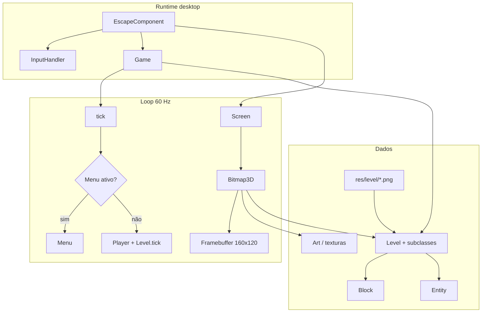

# Escape 3D (engine3d)

Jogo de aventura em primeira pessoa com renderização 3D por software, escrito em Java puro. O projeto combina um motor de raycasting leve, mapas definidos por imagem e lógica de jogo orientada a entidades e blocos interativos.

A resolução interna é 160×120 pixels, ampliada seis vezes na janela desktop. O loop principal fixa a simulação em 60 atualizações por segundo e desenha cada quadro com buffer duplo via AWT.

## Características

- Renderização estilo raycasting (`Bitmap3D`) com texturas, sprites e z-buffer
- Mapas carregados a partir de PNG em `res/level/`, com blocos e decoração derivados da cor e do canal alpha
- Inimigos, itens, chefes e projéteis como entidades atualizadas por nível
- Blocos com comportamento próprio: portas, escadas, baús, placas de pressão, água, vitórias, entre outros
- Áudio WAV em `res/snd/`
- Menu principal e menu de pausa (Swing/AWT sobre o canvas do jogo)
- Ponto de entrada desktop (`EscapeComponent`) e variante applet legada (`EscapeApplet`)

## Requisitos

| Item        | Versão mínima |
| ----------- | ------------- |
| Java (JDK)  | 17            |
| Maven       | 3.6+ (opcional, recomendado) |
| Apache Ant  | 1.9+ (opcional) |

Não há dependências externas além da biblioteca padrão do Java.

## Execução rápida

### Maven

Na raiz do repositório:

```bash
mvn compile exec:java
```

Para gerar o JAR com manifesto e recursos embutidos:

```bash
mvn package
java -jar target/engine3d-1.0-SNAPSHOT.jar
```

Os recursos em `res/` são copiados para o classpath durante o build.

### Apache Ant

```bash
ant run
```

Outros alvos úteis: `ant compile`, `ant jar`, `ant clean`.

### IDE

Importe o projeto como Maven ou projeto Java simples. A classe principal é `com.aronalvarenga.escape.EscapeComponent`. Garanta que a pasta `res` esteja no classpath de recursos (no Maven isso já está configurado no `pom.xml`).

## Controles

| Ação              | Teclas |
| ----------------- | ------ |
| Andar             | W / ↑ / Numpad 8 |
| Recuar            | S / ↓ / Numpad 2 |
| Strafe esquerda   | A (com Ctrl, Alt ou Shift para strafe) |
| Strafe direita    | D |
| Girar esquerda    | Q ou ← / Numpad 4 |
| Girar direita     | E ou → / Numpad 6 |
| Usar / interagir  | Espaço |
| Atacar            | Z |
| Trocar item (1–8) | Teclas 1 a 8 |
| Pausar            | Esc ou P |

Com o menu aberto, W/S ou ↑/↓ navegam, A/D movem a seleção quando aplicável, e Espaço ou Enter confirmam.

O jogo só processa entrada quando a janela está em foco; o cursor é ocultado durante o gameplay.

## Arquitetura



Fluxo resumido:

1. `EscapeComponent` acumula tempo real e chama `Game.tick` em passos fixos de 1/60 s.
2. `Game` delega ao menu ou atualiza jogador, entidades e blocos do `Level` atual.
3. `Screen` compõe o mundo 3D e a interface em bitmap; o canvas escala a imagem e desenha HUD e menus com `Graphics`.

## Estrutura do repositório

```
engine3d_base/
├── pom.xml              # Build Maven (Java 17, mainClass EscapeComponent)
├── build.xml            # Build Ant alternativo
├── res/
│   ├── level/           # Mapas PNG (nome do arquivo = id do nível)
│   ├── tex/             # Atlas de paredes, chão, sprites, UI
│   └── snd/             # Efeitos sonoros WAV
└── src/com/aronalvarenga/escape/
    ├── Game.java              # Estado global e regras de jogo
    ├── EscapeComponent.java   # Janela, loop e render
    ├── Art.java               # Carregamento de texturas
    ├── entities/                # Jogador, inimigos, itens, projéteis
    ├── level/                   # Level abstrato e níveis concretos
    │   └── block/               # Tipos de bloco e interações
    ├── gui/                     # Bitmap, Screen, sprites 2D
    └── menu/                    # MainMenu, PauseMenu, base Menu
```

## Sistema de níveis

Cada mapa corresponde a um arquivo `res/level/<nome>.png` e, em geral, a uma classe `com.aronalvarenga.escape.level.<Nome>Level` (primeira letra maiúscula). Exemplo: `start.png` → `StartLevel`.

Durante `Level.init`, cada pixel define o tipo de bloco (cor RGB) e metadados (canal alpha). A classe do nível pode sobrescrever `getBlock`, `decorateBlock`, `switchLevel` e `getLoot` para lógica específica.

Níveis carregados ficam em cache até `Level.clear()` (nova partida ou retorno ao menu principal).

Para adicionar um nível novo:

1. Crie o PNG no tamanho desejado em `res/level/`.
2. Implemente `<Nome>Level` extendendo `Level`.
3. Transite para ele com `Game.switchLevel("nome", spawnId)` (por exemplo a partir de `LadderBlock` ou `switchLevel` do nível).

## Desenvolvimento

- Codificação de fontes: UTF-8 no projeto; o `maven-compiler-plugin` usa CP1252 para compatibilidade com literais legados. Prefira ASCII ou escapes Unicode em strings novas se houver problema de encoding no ambiente.
- Assets não versionados: pastas `build/`, `dist/`, `target/` e artefatos `.jar` estão no `.gitignore`.
- Extensão natural do motor: novos blocos em `level/block/`, novas entidades em `entities/`, registro de comportamento no `tick` do nível ou do bloco.

## Créditos

Projeto desenvolvido por **Aron Alvarenga**. O repositório `engine3d_base` serve como base do motor e do jogo *Escape 3D*.

## Licença

Nenhum arquivo de licença está incluído neste repositório. Consulte o autor antes de redistribuir ou usar o código em produtos derivados.
